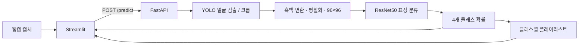

# EmotionCare

**표정 분류와 음악 추천을 연결한 딥러닝 응용 시스템**

웹캠으로 캡처한 얼굴에서 표정 클래스를 추정하고, 클래스별 플레이리스트를 제시하는 딥러닝 텀프로젝트입니다. 학습 파이프라인, 얼굴 검출·추론 API, 사용자 인터페이스를 분리해 구성했습니다.

`TensorFlow / Keras` · `ResNet50` · `YOLO` · `FastAPI` · `Streamlit`

## System Architecture



## Implementation

| 구성 | 구현 내용 | 코드 |
|---|---|---|
| 데이터 처리 | 원본 7개 라벨을 4개 클래스로 통합, 층화 무작위 분할, 학습 데이터 증강 | [ck_train.py](ck_train.py) |
| 모델 비교 | VGG16·ResNet50·EfficientNetB0 학습 구조, 동결 학습과 미세 조정 | [ck_train.py](ck_train.py) |
| 추론 API | 얼굴 검출·크롭, 입력 정규화, 클래스 확률·추천 목록 응답 | [backend/main.py](backend/main.py) |
| 사용자 화면 | 카메라 캡처, 분류 결과·확률 그래프, 추천 곡 링크 | [streamlit_app.py](streamlit_app.py) |

## Results & Contribution

- **모델–API–화면 연결:** 학습된 모델을 FastAPI 추론 엔드포인트로 제공하고 Streamlit 화면에서 호출하는 구조를 구현했습니다.
- **4개 출력 클래스:** `anger`, `happy`, `sadness`, `nervousness`에 대한 확률과 클래스별 추천 목록을 반환합니다.
- **비교 실험 구조:** 학습 곡선, 혼동 행렬, 분류 보고서를 저장하도록 구성했습니다.
- **개인 담당:** 팀 발표자료에 명시된 김동규의 담당은 **모델 학습·프로젝트 최종 검토**입니다. 서비스 전체는 팀 프로젝트 결과입니다.

음악 추천은 클래스별로 미리 정의한 목록을 선택하는 방식입니다. 표정 클래스는 프로젝트의 모델 출력이며, 실제 심리 상태나 치료 효과를 판정하는 결과가 아닙니다.

## UI Flow

| 왼쪽 패널 | 오른쪽 패널 |
|---|---|
| 카메라 입력과 촬영 이미지 | 예측 클래스 및 클래스별 확률 |
| 분석 버튼 | 분석에 사용한 얼굴 크롭과 추천 플레이리스트 |

사용자가 촬영하고 분석 버튼을 누를 때 추론을 요청합니다. 영상 전체를 연속 분석하는 스트리밍 방식과 구분됩니다.

## Run Locally

아래 명령은 이 폴더를 작업 디렉터리로 사용합니다. 학습 데이터와 모델 가중치는 별도로 준비해야 합니다.

```bash
python -m venv .venv
# 운영체제에 맞게 .venv 활성화
pip install -r requirements.txt
uvicorn backend.main:app --host 127.0.0.1 --port 8000
```

다른 터미널에서:

```bash
streamlit run streamlit_app.py
```

학습은 `CK_ROOT` 환경변수에 데이터 경로를 지정한 후 `python ck_train.py`로 시작합니다. 가중치 배치 위치와 평가 조건은 [실행 및 모델 문서](docs/model-and-api.md)를 참고하세요.

학습용 얼굴 이미지, 사용자 얼굴이 포함된 시연 영상, 모델 가중치는 공개 파일에 포함하지 않습니다. 공개본은 소스 검토와 문법 검사를 거쳤으며, 새 환경에서 모델 학습·추론을 다시 수행한 배포본은 아닙니다.
