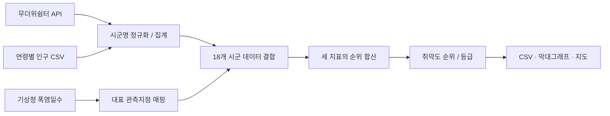
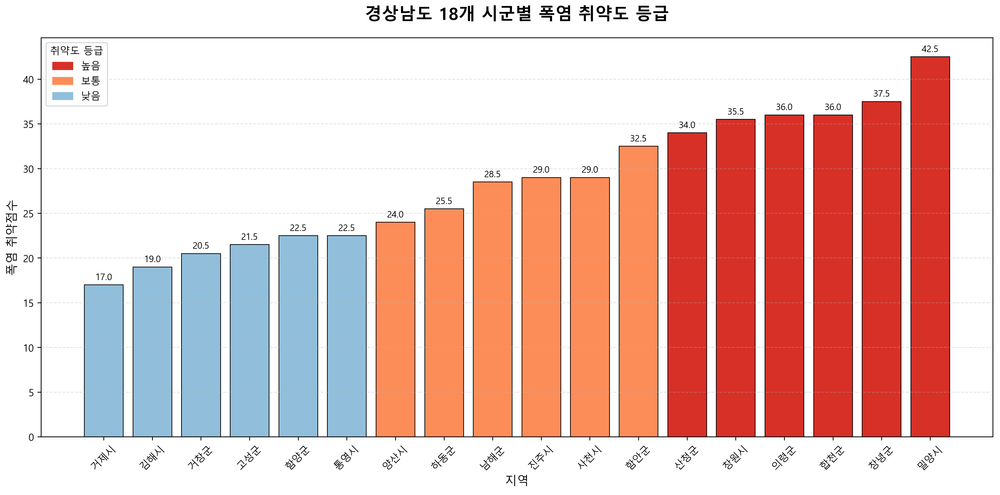

# Gyeongnam Heat Vulnerability Analysis

**공공데이터를 결합한 경상남도 18개 시군 폭염 취약도 비교**

폭염 노출, 고령 인구 비중, 무더위쉼터 공급을 함께 분석한 빅데이터 분석 텀프로젝트입니다. 서로 다른 출처의 데이터를 시군 단위로 통합하고, 순위 기반 지표를 통해 지역별 차이를 표·그래프·지도에 표현했습니다.

`Python` · `pandas` · `Matplotlib` · `Folium` · `Selenium`

## Analysis Pipeline



## Results



| 결과물 | 내용 |
|---|---|
| [최종 순위표](results/rankings.csv) | 18개 시군의 적용 지점, 입력 지표, 점수, 등급 |
| [등급 지도](results/vulnerability-map.html) | 행정구역별 색상 및 지표 툴팁. 파일을 내려받아 브라우저에서 열기 |
| [분석 노트북](notebooks/analysis.ipynb) | 수집·정제·결합·시각화 과정 |
| [점수 재계산](scripts/verify_scores.py) | 공개된 최종 표로 점수 일치 여부 확인 |

저장된 분석 결과에서 밀양시 42.5점, 창녕군 37.5점이 상위에 위치합니다. 합천군과 의령군은 각각 36.0점으로 동점입니다. 이는 **이 프로젝트의 입력 자료와 산정 방식에 따른 상대 비교**입니다.

## Method

`취약점수 = 폭염일수 순위 + 70세 이상 인구비율 순위 + 고령인구 1만 명당 쉼터 수의 역방향 순위`

- 폭염일수와 고령 인구 비율이 높을수록 점수가 커집니다.
- 고령 인구 대비 쉼터가 적을수록 점수가 커집니다.
- 동점 지표에는 평균 순위를 적용합니다. 세 지표는 동일 가중치로 합산합니다.
- 최종 정렬 순서의 1~6위는 높음, 7~12위는 보통, 13~18위는 낮음으로 나눕니다.

쉼터 수용률은 별도 비교 지표이며 점수 합산에 사용하지 않습니다. 점수와 등급은 공식 재난 경보 또는 미래 피해 예측값이 아닙니다.

## Engineering Highlights

- **데이터 통합:** 주소·행정구역명 정규화와 시군별 집계로 서로 다른 출처의 자료를 연결했습니다.
- **지표 설계:** 단순 쉼터 개수 대신 고령 인구 1만 명당 공급 수준을 반영했습니다.
- **분석 범위 확장:** 대표 관측지점을 매핑해 경남 18개 시군을 동일한 표에서 비교했습니다.
- **결과 전달:** 지표와 적용 관측지점을 지도 툴팁에 함께 표시해 분석 근거를 추적할 수 있도록 했습니다.

## Reproduce the Published Scores

이 폴더에서 실행합니다. API 키나 원본 데이터 다운로드 없이 공개된 표의 산식을 점검합니다.

```bash
pip install pandas
python scripts/verify_scores.py
```

전체 수집·분석을 다시 수행하려면 [데이터 출처와 실행 조건](docs/data-and-method.md)을 참고하세요. 팀 프로젝트 결과를 정리한 것으로, 자료에 없는 개인별 역할은 별도로 단정하지 않았습니다.
